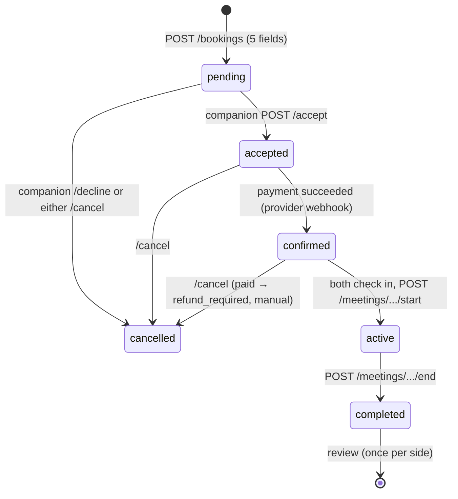
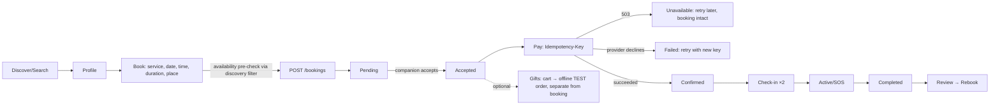

# YONDO design + prototype — handoff
Status: **prototype validated in headless Chromium against a contract-faithful mock; not validated against the real API or real devices.** See `reports/test-report.md` for exact results.

## Layout (all under `design-prototype/`, no production code touched)
`brand/` logo package + exploration boards · `design-system/` tokens, `components.css`, `components.md`, `gallery.html` · `prototype/` `src/{logic,mockapi,components,app,roles}.js`, `build.js`, built `index.html` · `screens/` six standalone screens · `tests/` Node + browser suites · `reports/` iterations, scoring, test report, screenshots · `docs/` audit, mapping, this file.
Commands: `node prototype/build.js` (build) · `node tests/run.js` (logic + contract) · `node tests/browser.js` (needs `@sparticuz/chromium`, `puppeteer-core`, `ajv`, `ajv-formats`, `axe-core`; env `REALFONTS=1 AXE=1 SWEEP='[360,390]'`).

## Flows (backend-accurate)

`no-show` and `disputed` exist in the enum but no endpoint moves a booking into them; the UI only labels them.

## Rules the UI enforces (from the contract)
Booking body is only `service_id, starts_at (UTC), duration_minutes (multiple of unit_minutes), meeting_place, timezone`. Payment only when `accepted`; `Idempotency-Key` 8–128 chars, new key after a failed attempt. Combined booking+gift checkout always returns 503 `combined_checkout_unavailable` and preview has `total_minor:null` → shown as unavailable, never faked. Fees may be unset (`payment_configuration_unavailable`). Money = `price_minor` + ISO currency (UZS exponent 2). Verification badge only when `verified===true`. SOS records an alert (`emergency_service_contacted:false`) — copy never promises dispatch or tracking. Gift category `romantic` is displayed as “Maxsus kunlar”.

## Error handling guide
Decide behaviour from `error.code` (+`status`), never from `message`. `YL.classify(err)` → `{code,text,kind,retry,rid}`; kinds: `form` (fix input, keep entered data), `stale` (refetch), `unavailable`/`offline`/`wait` (offer retry), `role`/`blocked` (explain, no retry), `auth` (re-login), `notfound`, `info`. Show `request_id` on errors. Unknown codes fall back to HTTP status. 503 is its own visual kind and must not look like a declined payment. 422 `validation_error` → map `errors[].loc` last segment to the field.

## Responsive & accessibility notes
Mobile-first; breakpoints 360/390/430/768/1024/1440; container 480→640→880. Native `<dialog>` modals (focus move, wrap, Esc, restore); skip link in header; headings focused after route changes (not on first load); `scroll-padding` keeps focus clear of fixed bars; `prefers-reduced-motion` honoured; live regions for status/alerts/chat log; labels/`aria-invalid`/`aria-describedby` on fields.

## Open contract questions (need backend owner)
1. **Report/block target — DECIDED, contract change pending:** see Decisions below. Remaining backend work: map profile id → user id and name the two id types distinctly in `openapi-v1.json`.
2. Discovery `available_from/until` semantics (containment vs overlap) are inferred; no public availability endpoint, so the UI pre-checks per slot.
3. Minor-unit exponent for UZS (assumed 2 = tiyin).
4. Platform fee, delivery fee, payout/earnings — undefined; UI shows “not determined”. (Cancellation percentage and refund rules: DECIDED, see Decisions.)
5. `/vendor/summary|orders` response schemas are untyped; vendor/companion “earnings” have no live source.
6. Whether “decline” maps to `cancelled` (assumed from the enum; no `declined` status).
7. Product decision: keep category `romantic` internally vs rename (brand forbids romantic wording).

## Decisions (from backend owner)
1. **Report target.** `reported_user_id` = the *user* id of the reported person, never the companion profile id. If the frontend only has a profile id, the backend must map it to the owning user, and the API contract/responses must label the two id types explicitly. Prototype status: it still sends the profile id (no user id is exposed to customers); this works only once the backend maps it. Action for backend: expose/name ids unambiguously.
2. **Cancellation and refunds.** Financial rules are not defined. Do not invent a cancellation percentage or refundable amount. Real refund calculation stays off. Payment-dependent checkout may return 503 while settings are missing, and test payments must never be mixed with real refunds. Prototype status: cancel dialog and booking page state that percentages/amounts are undefined and that no refund is calculated; a demo payment moves no real money; `refund_required` is shown only as a flag.

## Known limitations / risks
Mock instead of real API; Chromium-only; no screen reader/device/Safari/Firefox; no photo upload/WebSocket/notifications UI/admin; logo symbol not outlined, no merch, no legal clearance; Uzbek copy not reviewed by a native speaker; animations not profiled on budget Android.
